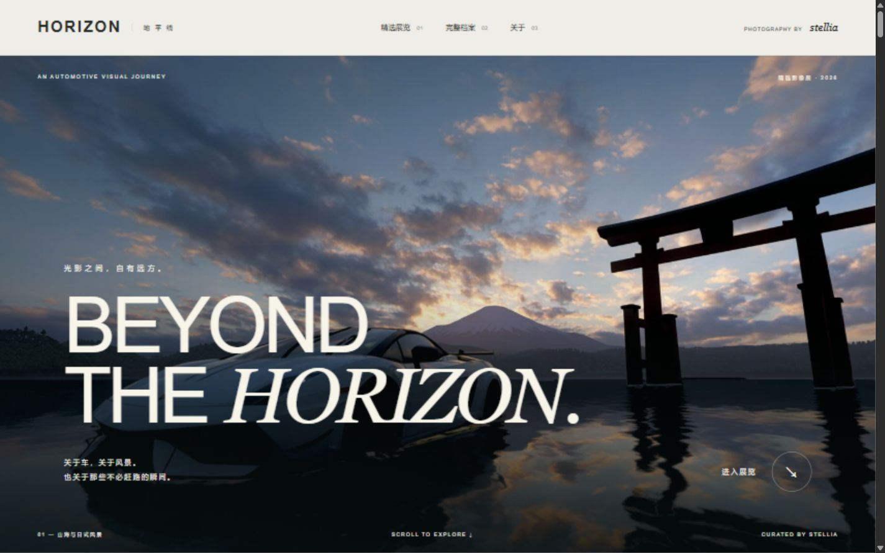

# HORIZON / 地平线

stellia 的汽车影像展。59 张精选影像、八个展览章节，以及收录 319 张作品的完整档案。

纯静态 HTML / CSS / JavaScript，不依赖第三方字体、CDN、服务端或账号。仓库包含完整网页及优化后的图片，可直接离线浏览；原始 PNG / JPG 不包含在仓库中。



## 预览

双击 `dist/index.html` 即可离线浏览。也可在此目录运行：

```powershell
python -m http.server 4173 --bind 127.0.0.1 --directory dist
```

然后打开 http://127.0.0.1:4173 。`start-preview.ps1` 提供快捷启动方式。

## 文件

- `dist/index.html`：页面结构与文案。
- `dist/style.css`：桌面和手机样式、轻量过渡与减少动态效果适配。
- `dist/app.js`：八章精选展览、完整档案搜索/筛选/分页、大图查看、键盘/触屏切换和自动播放。
- `dist/photos.js`：照片清单。
- `dist/photos/`：网页用 WebP 副本。缩略图最长边 640px；大图最长边 2400px，不放大小尺寸图片。大图入口是网页优化版，不是源文件下载。
- `scripts/prepare_photos.py`：从原照片重新生成网页资产，需要 Python 与 Pillow。

档案源目录包含 `01_汽车摄影`、`02_车型专题`、`03_AI视觉与海报` 三个子目录，精选源目录包含八个章节的子目录。档案按文件内容去除完全相同的重复文件，不合并不同导出版本；精选和档案共享相同内容的网页副本。源照片不作任何修改。

直接浏览无需安装依赖，也不需要原始照片。重新生成图片时，安装依赖并指定原始目录：

```powershell
python -m pip install -r requirements.txt
python scripts/prepare_photos.py --archive "path/to/Horizon" --selected "path/to/Selected"
```

在原作者工作区仍可使用默认参数运行 `python scripts/prepare_photos.py`。如调整精选文件的排序或章节，请同步调整 app.js 中的章节封面索引。

## 设计

深色全屏开场、暖白展厅、橄榄灰展签、暗色夜景章节。主展览包含全部精选作品，每章先展示少量照片，其余可展开；完整档案按需展示，避免一次加载全部图片。AI 视觉实验和游戏画面分别标注。

## 部署与使用

`dist/` 是完整静态站点目录，可交给静态网站服务器托管。推送 GitHub 仓库不等于发布网站，本项目未自动启用 GitHub Pages。

本仓库未附加开源许可；影像及相关素材的权利归各自权利人所有。
